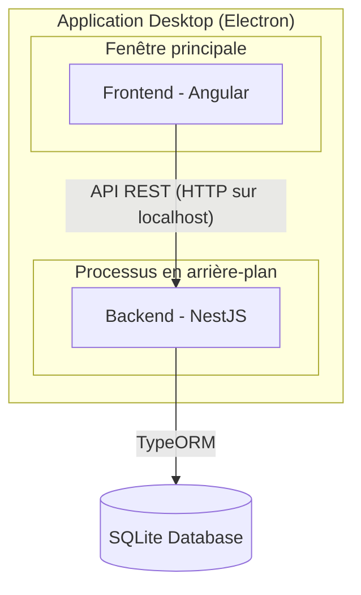

# Architecture du projet "Livret d'Évaluation"

Ce document décrit l'architecture technique de l'application "Livret d'Évaluation". Le projet est structuré en monorepo pour faciliter le partage de code et la gestion des différentes parties de l'application.

## 1. Vue d'ensemble

L'application suit une architecture client-serveur classique, mais entièrement contenue dans une application de bureau grâce à Electron.

- **Electron** agit comme une coquille (shell) qui lance un processus principal (Node.js) et une fenêtre de rendu (Chromium).
- La fenêtre de rendu charge l'application **Frontend** développée avec Angular.
- Le **Frontend** communique via des requêtes HTTP avec une API REST locale.
- Cette API est fournie par le **Backend** développé avec NestJS, qui s'exécute en arrière-plan.
- Le **Backend** gère la logique métier et interagit avec une base de données **SQLite** via l'ORM TypeORM.

Voici un diagramme illustrant les interactions :



## 2. Stack Technique

La sélection des technologies vise la robustesse, la productivité et la maintenabilité.

| Couche | Technologie | Rôle |
|---|---|---|
| **Desktop** | Electron | Encapsule l'application web pour en faire une application de bureau native. |
| **Frontend** | Angular 19 + Material | Fournit l'interface utilisateur réactive et structurée. |
| **Backend/API** | NestJS 11 | Offre une API REST modulaire et robuste pour la logique métier. |
| **Base de données** | SQLite + TypeORM | Assure la persistance des données dans un fichier local simple. |
| **Génération PDF** | pdfmake | Crée les livrets au format PDF côté serveur. |

## 3. Structure du Monorepo

Le projet est divisé en quatre répertoires principaux à la racine.

```
livret/
├── backend/          # API NestJS (port 3001)
├── frontend/         # Application Angular (port 4200 en dev)
├── electron/         # Shell Electron
└── shared/           # Types TypeScript partagés
```

- `backend/`: Contient l'API REST développée avec NestJS. Elle gère toute la logique métier, l'accès à la base de données et la génération de documents (PDF).
- `frontend/`: Contient l'application monopage (SPA) développée avec Angular. C'est l'interface utilisateur que l'enseignant manipule.
- `electron/`: Le projet qui encapsule l'application Angular pour en faire une application de bureau. Son rôle principal est de créer une fenêtre et de charger l'application web.
- `shared/`: Un répertoire crucial pour le monorepo. Il contient les définitions de types TypeScript (interfaces, enums) partagées entre le `frontend` et le `backend` pour garantir la cohérence des modèles de données.

## 4. Architecture Backend (NestJS)

Le backend est architecturé en modules, une pratique encouragée par NestJS pour une meilleure organisation du code.

```
backend/src/
├── entities/         # Entités TypeORM (Eleve, Domaine, etc.)
├── modules/
│   ├── eleves/       # Module CRUD pour les élèves
│   ├── domaines/     # Module CRUD pour les domaines
│   ├── competences/  # Module CRUD pour les compétences
│   ├── evaluations/  # Module pour la grille et la validation
│   ├── commentaires/ # Module pour les commentaires
│   └── pdf/          # Module de génération des PDF
├── seed/             # Service pour peupler la BDD avec des données initiales
└── app.module.ts     # Module racine
```

- **Modularité** : Chaque ressource (élève, compétence, etc.) possède son propre module contenant un `controller` (exposition des routes HTTP), un `service` (logique métier) et une `entity` (définition du modèle de données).
- **Persistance** : **TypeORM** est utilisé comme ORM pour mapper les entités aux tables de la base de données **SQLite**. Le choix de SQLite est idéal pour une application de bureau, car la base de données est un simple fichier (`livret.sqlite`) facile à gérer et à sauvegarder.
- **Configuration** : Le `AppModule` configure la connexion à la base de données et importe tous les autres modules de fonctionnalités.

## 5. Architecture Frontend (Angular)

L'interface utilisateur est construite comme une Single Page Application (SPA) avec Angular.

```
frontend/src/app/
├── services/
│   └── api.service.ts  # Service centralisé pour les appels HTTP
├── components/
│   ├── grille/         # Grille principale (élèves × compétences)
│   ├── livret/         # Visualisation du livret (dialog)
│   └── ...             # Autres composants UI
├── models/             # Liens symboliques vers le dossier `shared`
└── app-routing.module.ts # Gestion de la navigation
```

- **Composants** : L'interface est découpée en composants réutilisables (grille, formulaire, popup). **Angular Material** fournit une base solide de composants prêts à l'emploi.
- **Services** : La logique non liée à la vue, comme la communication avec le backend, est isolée dans des services injectables. Le `ApiService` centralise tous les appels à l'API NestJS.
- **Communication** : Le frontend communique exclusivement avec le backend via son API REST. Il n'accède jamais directement à la base de données.

## 6. Processus de Build et de Démarrage

Le `package.json` à la racine utilise `concurrently` pour orchestrer le démarrage des différents services en développement.

- `npm run dev`: Lance en parallèle le serveur de développement Angular et l'API NestJS en mode `watch`.
- `npm run build:all`: Construit les versions de production d'Angular et de NestJS.
- `npm run dist`: Exécute le build complet, puis utilise `electron-builder` pour empaqueter l'application en un installateur `.exe` pour Windows.